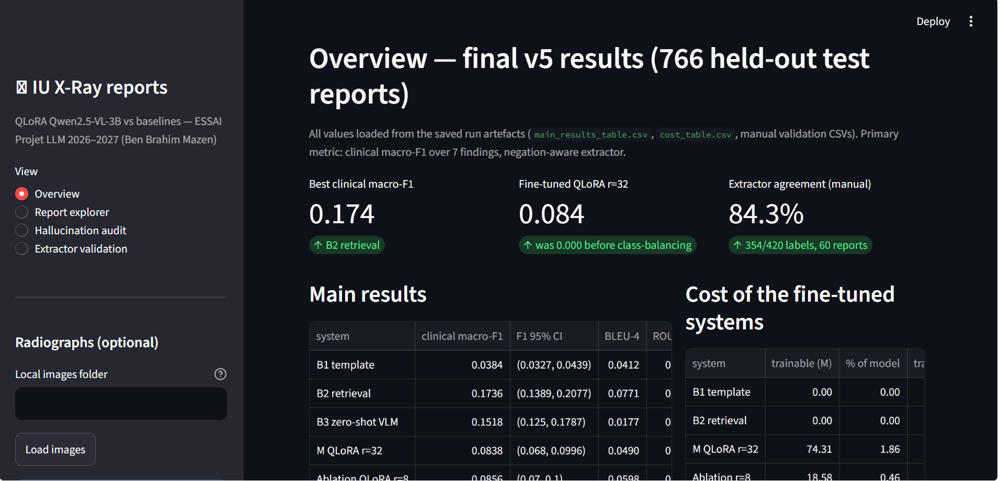

# Medical Report Generation from Chest X-rays

**Can a small vision-language model (Qwen2.5-VL-3B), parameter-efficiently fine-tuned with QLoRA, write clinically faithful chest X-ray reports — and how often does it hallucinate compared to zero-shot VLMs and classical baselines?**


An end-to-end research study, not just a model demo: five report-generation systems built and compared on the **same test split, same clinical-label extractor, same metrics**, with **bootstrap confidence intervals**, a **hand-validated measuring instrument** (420 labels), and a **manual hallucination audit** (50 reports). Every number in this README comes from the executed notebook's saved artefacts — nothing is quoted from wishful memory.

**Author: Ben Brahim Mazen · October 2026**

<p align="center">
  
</p>
<p align="center"><em>The demo's overview page (Section <a href="#9-interactive-demo-streamlit">9</a>): all values are loaded live from the saved run artefacts.</em></p>

---

## Contents

1. [Why this project](#1-why-this-project)
2. [Results at a glance](#2-results-at-a-glance)
3. [The five systems](#3-the-five-systems)
4. [Dataset and schemas](#4-dataset-and-schemas)
5. [Methods](#5-methods)
6. [Results](#6-results)
7. [Failure study: collapse → diagnosis → partial recovery](#7-failure-study-collapse--diagnosis--partial-recovery)
8. [Key findings and limitations](#8-key-findings-and-limitations)
9. [Interactive demo (Streamlit)](#9-interactive-demo-streamlit)
10. [Repository structure](#10-repository-structure)
11. [Reproducing the study](#11-reproducing-the-study)
12. [Credits, license and disclaimer](#12-credits-license-and-disclaimer)
13. [AI usage disclosure](#13-ai-usage-disclosure)

---

## 1. Why this project

Medical imaging volume keeps growing faster than reporting capacity, and the chest X-ray is the most frequently performed imaging examination worldwide. Every exam must end in a written report — and the report, not the image, is what other clinicians actually read. That mix — formulaic enough to look automatable, consequential enough to be dangerous to automate badly — is exactly the profile where language models promise a lot and fail subtly.

Report generators are usually benchmarked with n-gram overlap (BLEU/ROUGE), metrics known to reward generic, normal-sounding text. This project instead puts the clinical question first:

> Does QLoRA adaptation of a 3B vision-language model on IU X-Ray improve **label-level clinical fidelity** (7 findings, negation-aware), and what **failure modes** — output collapse, hallucinated or silently denied findings — appear along the way?

Three design principles run through everything:

- **A clinical metric as the primary metric**, with n-gram and embedding overlap kept only for context — and shown to disagree with it.
- **The measuring instrument is itself measured.** The rule-based label extractor was validated by hand against 420 author-labelled finding states, so every clinical number carries a *quantified* error bar instead of an assumed-correct rule base.
- **Hallucinations are counted by a human, not a rule.** 50 automatically flagged reports were read and classified one by one; 56% of the flags turned out to be artifacts of the extractor, not model errors.

## 2. Results at a glance

All numbers from the final run (v5), 766 held-out test reports, single seed:

| Question | Answer (measured) |
|---|---|
| Best system by clinical macro-F1 | **B2 — CLIP retrieval (0.174)**, *not* the fine-tuned VLM |
| Fine-tuned Qwen2.5-VL-3B (QLoRA r=32) | Clinical macro-F1 **0.084** (95% CI 0.068–0.100) — up from **0.000** before the class-balancing fix |
| Cost of that fine-tune | 74.3 M trainable params (**1.86%** of the model), **2.8 h** on one A10G, 8.4 GB peak, 284 MiB adapter |
| Total compute budget spent | ≈ **$29 of $30** cloud credit for the entire project (three full training runs + evaluation) |
| Hallucinations (manual audit, 50 flagged reports) | **56% were extractor errors, not model errors**; 26% real hallucinations (11 missed findings + 2 false normality claims); 18% correct |
| Extractor reliability (manual audit, 420 labels) | **84.3%** overall agreement; weakest label: *no acute finding* (48.3%) |

The honest headline: **the fine-tuned model did not beat a simple retrieval baseline on clinical fidelity, and overlap metrics (BLEU/ROUGE/BERTScore) rank the systems almost oppositely to clinical metrics.** The rest of this README documents why, and what it took to find out.

## 3. The five systems

| ID | System | Idea | Role in the study |
|---|---|---|---|
| B1 | Template | Constant output: the most frequent findings section among *normal* train reports | The deceptively strong floor on a normal-dominated dataset |
| B2 | CLIP retrieval | Embed the study with `openai/clip-vit-base-patch32`, copy the findings of the visually nearest training study (top-1 cosine) | Bounds what pure image similarity achieves with zero generation |
| B3 | Zero-shot VLM | Qwen2.5-VL-3B-Instruct, 4-bit, prompted as a radiologist; no training | What a modern small VLM already knows "for free" |
| M | **QLoRA r=32** | Same VLM, LoRA (attention + MLP) over a 4-bit NF4 base, completion-only loss | The main system under study |
| Abl. | QLoRA r=8 | Identical recipe, 4× smaller adapter | Single-knob capacity ablation |

```text
   IU X-Ray (3,826 reports · 7,430 images, XML + PNG)
        │
        ▼   Stage 2: clean → patient-level split → clinical-label extractor
   reports_stage2.csv · labels_stage2.csv          (schemas in §4)
        │                     split: 2,678 train / 382 val / 766 test
        ├── B1 template        ├── B2 CLIP retrieval ──┐
        ├── B3 zero-shot VLM ──┤                       ├── same extractor on every output
        └── M / Abl. QLoRA ────┘   766 saved generations per system
                                     │
                                     ▼
              clinical macro-F1 (primary) · BLEU-4 · ROUGE-L · BERTScore
              bootstrap 95% CIs · cost accounting
                                     │
                                     ▼
              manual audits: extractor validation (420 labels)
                             hallucination taxonomy (50 reports)
```

All five systems are evaluated **identically**: same test reports, same extractor, same metrics, same seeds — the comparison is apples-to-apples by construction.

## 4. Dataset and schemas

**IU X-Ray / Open-I** (Demner-Fushman et al., 2016, US National Library of Medicine): frontal/lateral chest radiographs with radiologist-written reports. After cleaning and patient-key joins: **3,826 reports / 7,430 images**, split **patient-level** (2,678 / 382 / 766) with leakage assertions — no patient appears in two splits.

Reference-positive prevalence in the test split (extractor labels), which drives the class-imbalance story of §7:

| Label | Prevalence | | Label | Prevalence |
|---|---|---|---|---|
| pleural effusion | 29.0% | | atelectasis | 7.0% |
| pneumothorax | 20.1% | | cardiomegaly | 5.1% |
| pneumonia/opacity | 19.6% | | edema | 3.9% |
| no acute finding | 15.5% | | | |

### 4.1 `reports_stage2.csv` — one row per report

| Column | Type | Description | Example |
|---|---|---|---|
| `report_file` | str | Report identifier (Open-I XML filename) | `1.xml` |
| `image_ids` | str | `\|`-joined image ids of the study | `CXR1_1_IM-0001-3001\|CXR1_1_IM-0001-4001` |
| `n_images` | int | Number of images in the study | `2` |
| `sec_comparison` | str | Raw *Comparison* XML section | `None.` |
| `sec_indication` | str | Raw *Indication* XML section | `Positive TB test` |
| `sec_findings` | str | Raw *Findings* XML section | `The cardiac silhouette and …` |
| `sec_impression` | str | Raw *Impression* XML section | `Normal chest x-XXXX.` |
| `findings` | str | Cleaned findings text | … |
| `impression` | str | Cleaned impression text | … |
| `target_text` | str | The generation target (findings section) — what systems are asked to write | … |
| `n_words` | int | Words in `target_text` | `34` |
| `patient_key` | str | Patient key used for the leakage-proof split | `CXR_1` |
| `split` | str | `train` / `val` / `test` | `train` |

### 4.2 `labels_stage2.csv` — extractor output, one row per report

| Column | Type | Description |
|---|---|---|
| `report_file`, `split` | str | Keys, as above |
| `st_<label>` ×7 | str | Finding state in **{positive, negated, uncertain, unmentioned}** (vocabulary below) |
| `bin_<label>` ×7 | int | Binarized view used by the primary metric: `1` iff `st_<label> == 'positive'` |

### 4.3 The label vocabulary — 7 findings × 4 states

| State | Meaning | Example clause |
|---|---|---|
| `positive` | Finding asserted present | *"small left pleural effusion"* |
| `negated` | Explicitly ruled out | *"no pneumothorax"*, *"without evidence of …"* |
| `uncertain` | Hedged / qualified | *"cannot exclude"*, *"possible"*, *"questionable"* |
| `unmentioned` | Never brought up in the text | — |

Labels: **cardiomegaly, pleural effusion, pneumonia/opacity, pneumothorax, edema, atelectasis, no acute finding (NAF)**. NAF is a derived *normality* label: when the text matches a normal-report pattern (*"no acute abnormality"*, *"unremarkable"*, …), NAF is set to `positive` — or `uncertain` if some other finding is asserted — and to `unmentioned` otherwise.

### 4.4 `generations_<system>.json` — saved outputs

JSON array with one object per test report (766 entries per system):

```json
{ "report_file": "10.xml",
  "hyp": "The heart is normal in size. The lungs are clear. ...",
  "latency_s": 2.51 }
```

Keeping the raw generations (not just scores) is what makes the demo, the audits and every number in this README re-checkable after the fact.

### 4.5 Manual-audit schemas

**`extractor_validation_sample.csv`** (60 reports): `report_file`, `split`, `target_text`, then for each of the 7 labels an `auto_<label>` column (extractor, 4-state vocabulary), a `manual_<label>` column (**P/N/U**, author's ground-truth reading), and an `ai_hint_<label>` column (clearly-marked AI first-pass suggestion the author confirmed or corrected), plus one `ai_hint_note`.

**`hallucination_sample.csv`** (50 reports): `report_file`, `pool` (FP/FN/clean), `auto_fp`/`auto_fn` (flagged label lists), `hyp`, `ref`, `ai_hint_category`/`ai_hint_reason` (first-pass suggestions), `manual_category`, `manual_notes`. Final categories ∈ **{real_fp, real_fn, extractor_error, correct}**.

## 5. Methods

### 5.1 Clinical label extractor (the measuring instrument)

A transparent, auditable rule extractor (notebook Stage 2.6; identical copy shipped in `app/demo_lib.py` with sanity asserts):

1. **Clause split** on `[,.;:]` and the word *but* — negation and assertion live in different clauses.
2. **Finding match**: synonym regexes per finding, e.g. *pneumonia/opacity* ← `pneumoni*|opacit*|consolidat*|infiltrat*|airspace disease`; *edema* ← `edema|oedema|pulmonary congestion|congestive heart failure`.
3. **Cue scan before the mention**, in the same clause — negation cues (`no`, `not`, `without`, `free of`, `absence of`, `negative for`, `rules out`, `resolved`, `denies`) and uncertainty cues (`cannot exclude`, `possible`, `questionable`, `may represent`, `suspected`, `concerning for`).
4. **Clause status** with fixed priority `uncertain > negated > positive`.
5. **Report-level aggregation** per label, plus the NAF normality rule above.

The same extractor labels the references *and* every system output — the comparison could not be fairer — and its own error is measured in §6.4.

### 5.2 Metrics

| Metric | Definition | Role |
|---|---|---|
| **Clinical macro-F1** (primary) | Each label binarized as `positive` vs rest; per-label F1 against the extractor labels of the reference; unweighted mean over the 7 labels | Decides the ranking |
| BLEU-4 | Corpus-level, `nltk` | Context (n-gram overlap) |
| ROUGE-L | Per-pair F1, mean over reports, `rouge_score` | Context (longest common subsequence) |
| BERTScore-F1 | `bert-score`, same references | Context (embedding similarity) |
| Latency | Mean seconds per report on one A10G, batch 1 | Deployment context |

**Uncertainty:** bootstrap over the 766 test reports — 1,000 resamples, fixed seed (42), percentile 2.5/97.5 CIs, applied to macro-F1, BLEU-4 and ROUGE-L. BERTScore is reported without a CI (compute cost — stated, not hidden).

### 5.3 QLoRA fine-tuning configuration (as actually run)

| Component | Value |
|---|---|
| Base model | `Qwen/Qwen2.5-VL-3B-Instruct` |
| Quantization | 4-bit NF4, double quantization (`bitsandbytes`), compute dtype bfloat16 |
| Image budget | `max_pixels = 448×448` (~256 visual tokens per image) |
| LoRA targets | LLM-side linear projections: `q,k,v,o` + `gate,up,down` — vision encoder untouched |
| LoRA rank / α / dropout | Main: 32 / 64 / 0.05 · Ablation: 8 / 16 / 0.05 |
| Trainable params | 74.31 M (**1.86%**) · 18.58 M (**0.46%**) |
| Objective | Completion-only next-token loss (prompt tokens masked) |
| Optimizer | AdamW, lr 2e-4, weight decay 0.01, cosine schedule, 30 warmup steps |
| Batching | 1 report/step × grad accumulation 8; gradient checkpointing (`use_reentrant=False`) |
| Epochs | 2 |
| Training pool | Class-balanced: 1,498 normal + 1,180 abnormal ×2 = **3,858 reports/epoch** (§7 explains why) |
| Stability guard | Batches with non-finite loss are skipped and logged (v5: 0 skipped for r=32, 5 for r=8) |
| Checkpointing | Adapter saved every 750 steps (unattended-run insurance) |
| Generation | Chat template, `max_new_tokens = 120` |

### 5.4 Baselines (as actually run)

- **B1** — constant string: the most frequent `target_text` among normal train reports.
- **B2** — CLIP ViT-B/32 image embeddings (batch 32, cached), top-1 cosine nearest training study; copy its findings text. No generation, no training.
- **B3** — the same 4-bit Qwen2.5-VL-3B, zero-shot, instructed: *"You are a radiologist reading a chest X-ray examination. Write the Findings section of the report for this study."*

### 5.5 Manual audits (the human in the loop)

- **Extractor validation:** 60 stratified reports × 7 labels = **420 finding states**, each read and labelled by the author as present/absent/unsure (P/N/U), blind to the extractor's answer. Agreement rule: P↔`positive`, N↔`negated` or `unmentioned`, U↔`uncertain`.
- **Hallucination audit:** the evaluation flags label contradictions between output and reference; 50 flagged reports (25 false-positive pool, 15 false-negative pool, 10 clean pool) were each read by the author and classified as **real hallucination (asserted-but-denied / silent miss), extractor error, or correct**. Worst cases are browsable in the demo.

## 6. Results

### 6.1 Main table — 766 test reports

| System | BLEU-4 | ROUGE-L | BERTScore-F1 | **Clinical macro-F1** (95% CI) | Latency/report |
|---|---|---|---|---|---|
| B1 template | 0.0412 | 0.2383 | 0.8772 | 0.0384 (0.033–0.044) | ~0 s |
| **B2 retrieval** | 0.0771 | 0.2400 | 0.8752 | **0.1736 (0.139–0.208)** | ~0 s |
| B3 zero-shot VLM | 0.0177 | 0.1740 | 0.8563 | 0.1518 (0.125–0.179) | 5.46 s |
| M QLoRA r=32 | 0.0490 | 0.2458 | 0.8788 | 0.0838 (0.068–0.100) | 2.51 s |
| Ablation QLoRA r=8 | 0.0598 | 0.2550 | 0.8807 | 0.0856 (0.070–0.100) | 2.81 s |

Read the three metric families carefully — they **disagree about the ranking**: BLEU favours B2, ROUGE-L/BERTScore favour the fine-tuned models, and the clinical metric exposes both. B3 has the *worst* BLEU of all five yet the *second-best* clinical F1. Optimizing overlap metrics on this data rewards generic normal text.

### 6.2 Per-label clinical F1 — where the differences actually live

| Label (test prevalence) | B1 | B2 | B3 | M r=32 | Abl. r=8 |
|---|---|---|---|---|---|
| pleural effusion (29.0%) | 0.000 | 0.269 | **0.406** | 0.000 | 0.000 |
| pneumothorax (20.1%) | 0.000 | **0.204** | 0.104 | 0.080 | 0.145 |
| pneumonia/opacity (19.6%) | 0.000 | 0.191 | **0.237** | 0.223 | 0.174 |
| no acute finding (15.5%) | 0.269 | 0.182 | 0.108 | **0.284** | 0.280 |
| atelectasis (7.0%) | 0.000 | 0.096 | **0.096** | 0.000 | 0.000 |
| cardiomegaly (5.1%) | 0.000 | **0.185** | 0.111 | 0.000 | 0.000 |
| edema (3.9%) | 0.000 | **0.089** | 0.000 | 0.000 | 0.000 |
| **Macro-F1** | 0.038 | **0.174** | 0.152 | 0.084 | 0.086 |

What the macro numbers hide:

- **Zero-shot beats everything on effusion**: B3 reaches F1 0.406 with recall 0.685 — the pre-trained VLM already "sees" the most prevalent finding, for free.
- **Retrieval is balanced by construction**: B2's F1s cluster tightly (0.09–0.27) because copied radiologist text asserts and negates findings in realistic proportion.
- **The fine-tuned models dropped effusion and cardiomegaly to zero** — after the collapse fix they over-assert normality: NAF recall 0.924 at precision 0.168 (r=32). The one abnormality they sharpened is pneumonia/opacity (precision 0.468, the study's highest, at recall 0.147).
- **Rare labels (edema, 3.9%) are where every system dies** — B2's copied text at least sometimes mentions them.

### 6.3 Cost and efficiency

| System | Trainable params | % of model | Train time | Peak GPU | Adapter size | Report latency |
|---|---|---|---|---|---|---|
| M QLoRA r=32 | 74.31 M | 1.86% | 2.80 h (A10G) | 8.36 GB | 283.6 MiB | 2.51 s |
| Ablation r=8 | 18.58 M | 0.46% | 2.76 h (A10G) | 7.39 GB | 71 MiB | 2.81 s |
| B3 zero-shot | — | — | 0 | — | — | 5.46 s |
| B1 / B2 | — | — | 0 | CPU | — | ~0 s |

Training losses fell from 2.69 → 0.74 (r=32) and 2.75 → 0.84 (r=8) over 2 epochs — the models *learned*; the per-label table shows what they learned was mostly the wrong prior. The rank ablation is flat (0.084 vs 0.086): at this data scale, adapter capacity is not the binding constraint — the training distribution is.

### 6.4 Extractor validation — how much the ruler can be trusted

Author's 420 hand labels vs the extractor: **354/420 = 84.3% agreement**.

| Label | Agreement | | Label | Agreement |
|---|---|---|---|---|
| cardiomegaly | 96.7% | | pneumothorax | 80.0% |
| pneumonia/opacity | 96.7% | | pleural effusion | 76.7% |
| atelectasis | 96.7% | | **no acute finding** | **48.3%** |
| edema | 95.0% | | | |

The 66 disagreements are not noise — they quantify exactly the two designed-in failure modes of a clause-local rule: **32** findings marked `positive` on text that negates them (the *"No effusion, pneumonia or pneumothorax"* list-negation gap: the cue licenses only the first item) and **26** genuinely asserted findings left `unmentioned` (mostly *"lungs are clear"*-style phrasing that never names the finding). The remaining 8 are scattered uncertainty pairings. Every clinical number in this study therefore carries a measured instrument error, largest exactly on the normality label everyone loves to quote.

### 6.5 Hallucination audit — 50 flagged reports, read by a human

| Author category | Count | Share | Meaning |
|---|---|---|---|
| extractor_error | 28 | 56% | The automatic flag is an artifact, not a model error |
| real_fn | 11 | 22% | Real finding silently missed |
| real_fp | 2 | 4% | Finding asserted that the reference denies |
| correct | 9 | 18% | Flag fired but the output was actually right |
| **Real hallucinations total** | **13** | **26%** | 11 silent misses + 2 false normality claims |

By pool: FP {22 extractor errors, 2 real_fp, 1 real_fn} · FN {9 real misses, 6 extractor errors} · clean {9 correct, 1 real miss}. The worst case found: report **91.xml** — the model writes *"There is no pneumothorax"* against a reference that measures a **3.2 cm right pneumothorax**. Two more (297.xml, 808.xml) are normal-sounding templates on abnormal films. The real failures cluster exactly where it matters clinically: silent misses of abnormal findings.

The methodological point is the 56%: **automatic hallucination flags overstate hallucinations**, and any hallucination statistic without a manual audit behind it should be read with suspicion.

## 7. Failure study: collapse → diagnosis → partial recovery

The project's most instructive result came from failure, and it is fully preserved in the repo (executed notebooks of each run in `archive/`, train logs in `results/`).

| Run | Change | Outcome |
|---|---|---|
| **v3** — first clean run | Naive pool (natural imbalance: ~56% normal) | Both fine-tuned models **collapsed to one generic normal report**: clinical macro-F1 **0.000**, zero false positives, **455/766** test reports with silently missed findings |
| **v4** — mitigation | *Only* change: class-balanced oversampling (abnormal ×2) | Recurring **NaN training losses** from ~step 1,300 (known 4-bit instability) — the logged loss curve goes NaN and stays NaN; run salvaged nothing |
| **v5** — final | Balanced pool **+ NaN skip-guard** + checkpoints | Clinical macro-F1 **0 → 0.084** (CI excludes 0) — a real, gated improvement. But collapse only **partial**: 6 unique hypotheses for 766 reports, one template covering 86%; the error mass flipped from missed findings (FN 455) to over-asserted normality (pools FP 588 / FN 46 / clean 132; NAF precision 0.17) |

Diagnosis of v3: the majority-class shortcut — on a normal-dominated dataset, "always say normal" is a near-optimal *training* loss solution and a catastrophic *clinical* one. The one-line oversampling fix moved the primary metric off zero; it did not by itself teach diversity. That gap (and the budget: $29 of $30 spent) is the honest frontier this study stops at.

## 8. Key findings and limitations

**Findings**

1. **A 3B VLM + QLoRA (1.9% params, 2.8 GPU-hours) is not enough to beat retrieval on clinical fidelity here** — B2's copied radiologist text (0.174) wins over the fine-tuned model (0.084) and even zero-shot (0.152) on macro-F1.
2. **Overlap and clinical metrics rank systems almost oppositely** — BLEU favours the retrieval baseline, BERTScore favours the fine-tuned models, clinical F1 exposes both. Metric choice *is* the conclusion on normal-dominated report data.
3. **Class imbalance is the dominant failure mode**, and class-balanced oversampling is a one-line fix that lifts clinical F1 from a hard zero — but not to diversity.
4. **Automatic hallucination flags overstate hallucinations by ~2×** (56% of flags were extractor artifacts). Manual audits are not optional.
5. **A transparent rule extractor is auditable and honest but weakest exactly on normality phrasing** (48.3% agreement on NAF) — the price of clause-local negation scope.

**Limitations** — single dataset (IU X-Ray), single seed, 3B model class only, 2 training epochs capped by budget; the extractor is English-only rule-based (validated, not perfect); the demo replays saved generations rather than running live inference. Not a clinical tool.

## 9. Interactive demo (Streamlit)

```bash
cd app && pip install -r requirements.txt && streamlit run app.py
```

The demo **replays the real v5 generations** — no live model, no GPU needed:

- **Overview** — main results with CIs, training cost, hallucination taxonomy, key findings (the screenshot at the top of this README).
- **Report explorer** — any of the 766 test studies: radiograph (26 PNGs bundled, covering 42 studies; point the sidebar at a full local IU X-Ray copy for the rest), the radiologist reference, and all five systems' actual outputs with per-label agreement chips and latency.
- **Hallucination audit** — filter the 50 audited reports by pool/category, read hypothesis vs reference side by side, including the 91.xml worst case.
- **Extractor validation** — the agreement table and mismatch matrix recomputed live from the CSV, plus a per-report browser comparing extractor vs author labels.

## 10. Repository structure

```text
├── README.md                                   ← this file
├── medical_report_generation.ipynb             ← the study: Run-All notebook (source, 51 cells)
├── medical_report_generation_v5_executed.ipynb ← executed final run (all outputs embedded)
├── extractor_validation_sample.csv             ← 60-report manual validation (author-filled, FINAL)
├── hallucination_sample.csv                    ← 50-report manual hallucination audit (author-filled, FINAL)
├── manual_review_page.html                     ← offline review tool used for the manual passes
├── headless_run.py                             ← Modal app that executed the notebook server-side
├── artefacts_pack.zip                          ← everything: adapters, generations, stage CSVs, logs, demo (attached to the GitHub Release — too large for git)
├── assets/                                     ← screenshots
├── results/                                    ← v5 tables, per-label CSVs, train logs, generations
├── app/                                        ← Streamlit demo
│   ├── app.py · demo_lib.py · requirements.txt
│   ├── demo_data/                              ← generations of all 5 systems + corpus + labels + tables
│   └── sample_images/                          ← 26 bundled IU X-ray radiographs
├── archive/                                    ← earlier notebook versions (incl. the v3 collapse record)
└── _scratch/                                   ← one-off development scripts (not part of the study)
```

## 11. Reproducing the study

Hardware used: one NVIDIA A10G on [Modal](https://modal.com), pay-per-second; the entire project — three full training runs plus all evaluation — cost **≈ $29 of $30 free credit**.

1. **Data** — IU X-Ray images and XML reports:
   - Official (NLM): `openi.nlm.nih.gov` → `NLMCXR_png.tgz`, `NLMCXR_reports.tgz`
   - Mirror (Kaggle): `raddar/chest-xrays-indiana-university`
2. **Notebook** — open `medical_report_generation.ipynb` and Run All. Stages 1–8: setup/data → cleaning, patient split, extractor → metrics + baselines B1/B2 → VLM load, B3, smoke test → QLoRA training + ablation → main results with CIs → hallucination/cost analysis → discussion. Everything fills from real runs; manual-validation cells guard against overwriting filled CSVs.
3. **Server-side execution** (what produced the final run): `modal deploy headless_run.py`, then spawn the run function (A10G, volume-mounted, `jupyter nbconvert --execute`). The executed notebook and `artefacts_pack.zip` are written back to the volume.
4. **Demo** — Section 9.

## 12. Credits, license and disclaimer

- **IU X-Ray / Open-I** — Demner-Fushman et al., 2016, US National Library of Medicine (data under its own terms)
- **Qwen2.5-VL-3B-Instruct** — Alibaba Qwen team (Apache-2.0)
- **CLIP ViT-B/32** — `openai/clip-vit-base-patch32`
- Libraries: `transformers`, `peft`, `bitsandbytes` (QLoRA: NF4, double quant), `nltk` / `rouge_score` / `bert-score` (metrics), `pandas`, `streamlit`, `modal`

Code released for research and educational use. **Not a medical device** — deployment would need radiologist review, calibration, and prospective validation.

## 13. AI usage disclosure

Claude (Anthropic) was used **as a code assistant only**: scaffolding code, regex drafts, and tooling for the review pages. **All scientific choices (design, systems, metrics, thresholds, cut decisions) were made by the author, who ran every experiment and every manual labelling pass himself.** For the two manual passes, Claude additionally produced a clearly-marked *first-pass suggestion* (`ai_hint_*` columns) for every item; the author read every report and set every final label (`manual_*`), confirming or correcting those suggestions. All agreement and hallucination statistics in this study are computed from the author's final labels only. The full disclosure text is in the notebook (§AI usage).

---

*Ben Brahim Mazen · October 2026*
